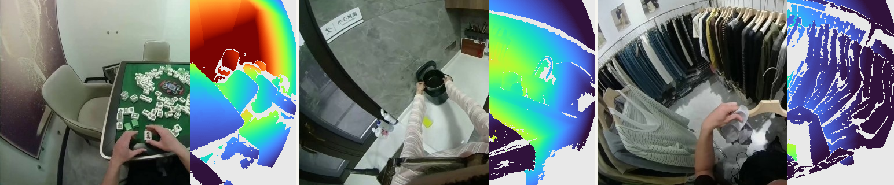

# EgoDepth-Bench

**Benchmarking Metric Depth for Egocentric Manipulation**

Yuan Gao (corresponding author), Dongchen Wei (project lead), Xinyang Lin, Shuhua Cao, Xueliang Guo, Zhuohan Li, Yihao Wang · GenRobot

[Paper (PDF)](https://egodepth-bench.github.io/site-assets/egodepth-bench.pdf) · [Project page](https://egodepth-bench.github.io/) · [Dataset (Hugging Face, private)](https://huggingface.co/datasets/genrobot2025/EgoDepth-Bench) · [Interactive RGB–depth sequences](https://egodepth-bench.github.io/#sequence-gallery) · [Paper results](results/README.md)

How accurately can a head-worn camera recover the depth of a moving hand and the object it holds? EgoDepth-Bench pairs six synchronized fisheye RGB views with reference depth for camera 2. We report **error and coverage together**. FoundationStereo predicts depth for 35.4% of reference-valid pixels in the 0.25–2.0 m scoring range, with a mean absolute depth error of 7.35 cm on those pixels. Both figures give each test site equal weight.

[](https://egodepth-bench.github.io/#sequence-gallery)

*Camera 2 at the same instant in RGB and reference depth. Select the image to play a sequence and move the RGB–depth divider.*

The dataset contains **941,233 timestamps across 37 physical sites**. The paper compares **18 models in 24 configurations** on **6,574 test anchors from eight sites**. A subset of 800 test anchors supports interaction diagnostics. This release includes the evaluator, baseline runners, training recipe and archived scores. To download the starter or the full dataset, sign in to Hugging Face with an account that has access to the dataset repository.

## Recreate the paper tables

With Git and Python 3.10+, run:

```bash
git clone --branch main --single-branch https://github.com/Chris004869/EgoDepth-Bench.git
cd EgoDepth-Bench
python scripts/export_archived_results.py --output outputs/tables
```

This uses the Python standard library and bundled per-site statistics. Open `outputs/tables/all_configurations.md` to compare the 24 configurations, or `outputs/tables/verification.json` to inspect the checks. The exporter runs on CPU without downloading a dataset or a checkpoint.

One comparison from the paper follows. All three MapAnything configurations receive the same six RGB views, calibration and camera-to-rig poses.

| MapAnything configuration | Full-image AbsRel ↓ | Object MAE (cm) ↓ |
| --- | ---: | ---: |
| Public checkpoint | 0.708 | 33.81 |
| Public checkpoint + scale fitted on training data | 0.601 | 29.05 |
| Fine-tuned on EgoDepth-Bench | 0.091 | 5.21 |

The full-image column uses all test anchors. The object column uses accepted annotations with reference support. The benchmark pools pixels within each site, then weights sites equally. All three configurations cover 100.0% of the evaluated object pixels at the paper's reporting precision. [Archived tables and provenance](results/README.md)

## Score your own predictions

From the code checkout, install the base package and check the scoring path with three synthetic frames:

```bash
python -m venv .venv
source .venv/bin/activate
python -m pip install -e .
python examples/synthetic_smoke.py
```

Expected output includes **AbsRel 0.1875**, **MAE 12.5 cm** and **coverage 0.75**. You can run this example before obtaining any benchmark data.

For an official evaluation, restore the v1 release and write one `<sample_token>.npz` per test anchor. Each file contains two arrays on the native camera-2 grid (416 rows × 512 columns):

| Array | Type | Meaning |
| --- | --- | --- |
| `depth_z` | Floating point | Optical-axis Z in meters |
| `valid` | Boolean | Pixels where your model supplies a prediction |

```bash
egodepth-score --release-root /path/to/egodepth_v1 \
  --predictions-dir /path/to/predictions --method my_model \
  --output outputs/my_model.json
```

The default scores metric predictions directly. For relative-depth outputs, the guide specifies how to supply the raw representation and label results that use reference depth for alignment. [Evaluation protocol](docs/EVALUATION.md)

## Reproduce an experiment

| Task | Guide |
| --- | --- |
| Read the 12-anchor starter, restore a split or inspect a calibration | [Data and SDK](docs/DATA.md) |
| Prepare and run one of the 18 baseline models | [Models, weights and environments](docs/MODELS.md) |
| Reproduce training-set scale calibration or six-GPU fine-tuning | [MapAnything adaptation](docs/TRAINING.md) |
| Re-score saved predictions and check the effect of rig poses on common pixels | [Independent verification and rig controls](docs/EVALUATION.md) |
| See which results were verified from archives, pixels or fresh inference | [Release validation](docs/VALIDATION.md) |

## Citation

```bibtex
@misc{gao2026egodepthbench,
  title  = {EgoDepth-Bench: Benchmarking Metric Depth for Egocentric Manipulation},
  author = {Gao, Yuan and Wei, Dongchen and Lin, Xinyang and Cao, Shuhua
            and Guo, Xueliang and Li, Zhuohan and Wang, Yihao},
  year   = {2026},
  url    = {https://egodepth-bench.github.io/}
}
```

GenRobot's code is licensed under [Apache-2.0](LICENSE) and the EgoDepth-Bench dataset under [CC BY-SA 4.0](https://creativecommons.org/licenses/by-sa/4.0/). Third-party code, weights and datasets have their own terms. [Third-party notices](docs/THIRD_PARTY.md) · [Citation metadata](CITATION.cff)

For reproducibility questions, [open an issue](https://github.com/Chris004869/EgoDepth-Bench/issues) or contact Yuan Gao at **gaoyuan100@outlook.com**.
